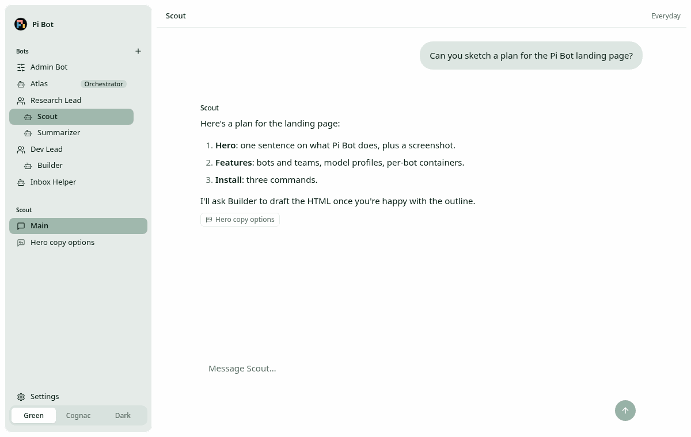
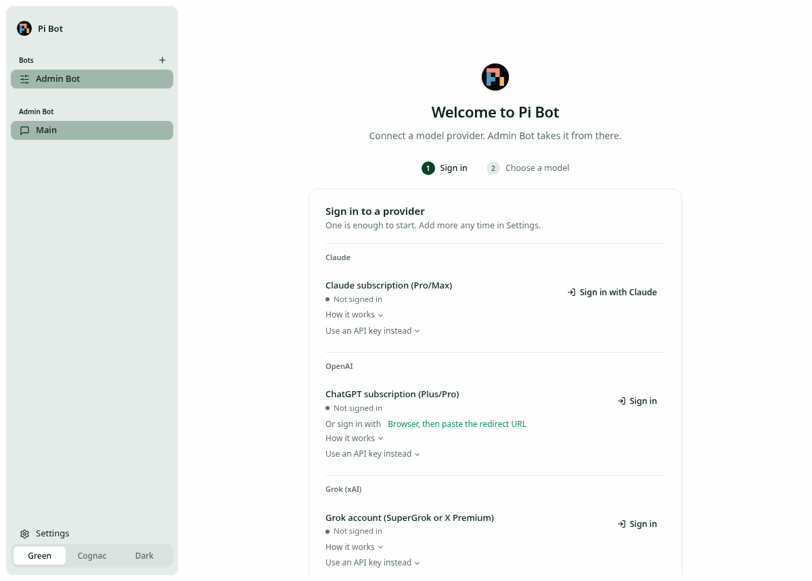

# Pi Bot

> **In development, not done.** Pi Bot runs, but it is unfinished: some configured features are
> not implemented yet (see [Not implemented yet](#not-implemented-yet)), and
> config, storage and protocol may still change.

Pi Bot is a self-hosted assistant made of several bots that work together, built on
[Pi Durable](https://www.npmjs.com/package/@earendil-works/pi-durable). One server process runs
all your bots against one SQLite database, on your own machine, reachable only from your
tailnet. MIT licensed.

Built through Trey Moore's agent-driven workflow: the commits come from `macagent131`, working
under his direction.



## What you get

- **Bots with roles.** **Admin Bot** is created on first start; it sets up accounts, profiles
  and other bots for you. An optional **Orchestrator** oversees everything. **Managers** lead
  one-level teams of regular **bots**. Bots can create bots and message each other.
- **Model profiles.** Each bot runs one profile: a main model, 0–5 fallback models and a pool
  of subagent models the main model can hand tasks to (`run_subagent`).
- **Honest limit notices.** When a subscription hits its 5-hour or weekly limit, or an API key
  runs out of credits, the chat says exactly what the provider reported, the bot moves to its
  next fallback, and it switches back when the limit resets. Reset times are never guessed.
- **Threads with auto-compaction.** Every bot has one long-lived main channel; threads fork off
  any message and inherit its context. Long contexts are compacted automatically, natively
  where the provider supports it. Nothing is deleted from the database unless you permanently
  delete a deleted bot.
- **Per-bot Docker environments.** Optionally, each bot gets its own container with a
  persistent workspace, where its bash/read/write/edit tools run.
- **Subscription sign-ins and API keys.** Claude, ChatGPT and Grok subscriptions, plus API keys
  for Anthropic, OpenAI, xAI, OpenRouter and OpenCode Go. All sign-ins work headless, from a
  browser on any device. Secrets are stored encrypted and are write-only in the UI.
- **Tailnet-only by design.** The server binds only to loopback or Tailscale addresses and
  rejects non-local `Host`/`Origin` headers. There is no app-level login, so it must never be
  exposed publicly. See [docs/security.md](docs/security.md).

## Quick start

Requires Node ≥ 22.19 and pnpm 12 (Docker only if you want per-bot environments).

```sh
pnpm install
pnpm build
mkdir -p ~/.config/pi-bot
cp config.example.toml ~/.config/pi-bot/config.toml   # required; edit [profiles.default]
pnpm start                                            # http://127.0.0.1:4317
```

Open the page, sign in to one provider and pick a main model if asked; Admin Bot takes it from
there. Keys can also be set from a terminal:

```sh
node packages/server/dist/cli.js set-key <provider>   # hidden input or stdin, stored encrypted
node packages/server/dist/cli.js login <provider>     # openai-codex, claude-subscription, xai
node packages/server/dist/cli.js credentials          # list (provider and type only)
node packages/server/dist/cli.js logout <provider>
```

To use it from your other devices, keep it on loopback and share it on your tailnet only:
`tailscale serve --bg --https=10443 http://127.0.0.1:4317` (never `tailscale funnel`). Running
it as a systemd user service is covered in [docs/configuration.md](docs/configuration.md).



## Documentation

| Doc                                                            | What it covers                                                                   |
| -------------------------------------------------------------- | -------------------------------------------------------------------------------- |
| [docs/configuration.md](docs/configuration.md)                 | `config.toml`, profiles, fallbacks, compaction, Settings, restart, service setup |
| [docs/providers-and-sign-in.md](docs/providers-and-sign-in.md) | Every provider and search key, headless sign-in flows, the Claude caveat         |
| [docs/bots-and-teams.md](docs/bots-and-teams.md)               | Roles, teams, the orchestrator, bot tools, threads, deleting and restoring       |
| [docs/environments.md](docs/environments.md)                   | Per-bot Docker containers: image, lifecycle, git access                          |
| [docs/security.md](docs/security.md)                           | Network model, credential storage, what enters a container                       |
| [config.example.toml](config.example.toml)                     | Every config key, with its default                                               |
| [AGENTS.md](AGENTS.md)                                         | Working agreement for agents changing this repo                                  |

## How it fits together

| Path                     | What                                                                                        |
| ------------------------ | ------------------------------------------------------------------------------------------- |
| `packages/server`        | `@wovenmatter/pi-bot`: config, storage, bot manager, tools, credentials, WebSocket API, CLI |
| `packages/server/docker` | The per-bot environment image                                                               |
| `apps/web`               | React client: sidebar with bots and teams, chat with streaming, threads, Settings           |

Each bot is one Pi Durable session; its tables are prefixed `pibot_<botId>_` in the shared
database, next to a small registry. Pi Durable's store is the source of truth: on startup,
interrupted runs resume, forks that crashed before being registered are adopted as threads, and
missing thread titles are regenerated. Credentials are shared by all bots.

The client uses a subset of the Woven Matter Enterprise web styles with the same three themes
(Green, Cognac, Dark).

## Development

```sh
pnpm dev:server   # server with --watch on 127.0.0.1:4317
pnpm dev:web      # Vite on http://127.0.0.1:5173, proxies /ws and /health
pnpm check        # build, typecheck, lint (Biome) and tests (Vitest)
```

Tests never call a real provider: they use pi-ai's faux provider, fake provider HTTP endpoints
and placeholder credentials, so no API keys are needed. The screenshots in `docs/images` come
from a throwaway instance with a faux "demo" provider and sample bots.

## Not implemented yet

- **macOS Keychain store on a real Mac.** It is implemented over the `security` CLI but only
  unit-tested with a fake; see [security](docs/security.md#credentials).

## Credits and caveats

- The brand mark is Pi's official colour logo from the [Pi press kit](https://pi.dev/press-kit)
  (Pi is MIT licensed), used unchanged.
- **Claude sign-in** stores the token from Anthropic's own `claude setup-token`. Anthropic's
  terms say third-party products shouldn't store Claude.ai tokens without approval, so this is a
  gray area for a self-hosted tool; the Anthropic API key is the fully sanctioned alternative.
  Details in [docs/providers-and-sign-in.md](docs/providers-and-sign-in.md#claude-caveat).
