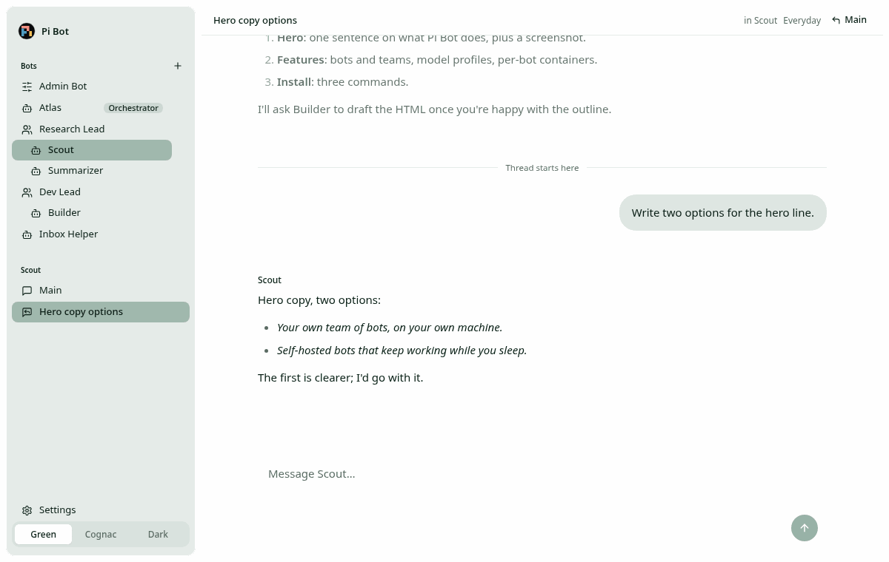

# Bots and teams

## Roles

Roles describe what a bot does and are separate from its name.

- **Admin Bot** is created on first start. There is exactly one; it can't be deleted, renamed or
  put on a team. It is the only bot with account and config tools, confirms config changes you
  didn't ask for, and never asks for secrets in chat. Its first conversation asks about your
  subscriptions, keys and budget, proposes profiles and creates the bots and teams you want.
- **Orchestrator** (optional, at most one) oversees every bot and team. It is never a team member
  but may lead its own team. Setting a new one replaces the old, which stays a normal bot.
- **Managers** lead one-level teams. Any bot but Admin Bot can be a manager; managers have no
  manager. Demoting or deleting a manager ungroups its team.
- **Bots**: everyone else, team members included.

The sidebar pins Admin Bot, then the orchestrator, then nests members under their manager.
Manage all of this in Settings → Bots, by asking Admin Bot, or by telling a bot itself.

## Bot tools

| Who                 | Tools                                                                                                                                                                                                                                                                                                                                        |
| ------------------- | -------------------------------------------------------------------------------------------------------------------------------------------------------------------------------------------------------------------------------------------------------------------------------------------------------------------------------------------- |
| Every bot           | `list_bots`, `create_bot`, `message_bot`, `web_search`, `fetch_url`                                                                                                                                                                                                                                                                          |
| Every bot but Admin | `rename_me`, `my_team` (`start`, `add`, `remove`, `stop`, `become_orchestrator`, `stop_orchestrator`)                                                                                                                                                                                                                                        |
| Admin Bot only      | `rename_bot`, `set_team` (`promote`, `demote`, `join`, `leave`, `replace_manager`, `make_orchestrator`, `clear_orchestrator`), `settings_status`, `read_config`, `update_config`, `restart_server`, `list_profiles`, `save_profile`, `delete_profile`, `set_default_profile`, `set_bot_profile`, `read_account_notes`, `write_account_notes` |
| Bots with a pool    | `run_subagent`                                                                                                                                                                                                                                                                                                                               |
| With Docker on      | `bash`, `read`, `write`, `edit`, run in the bot's container ([environments](environments.md))                                                                                                                                                                                                                                                |
- **`web_search`** `{query, count?}` (1–10, default 5) uses `[search] provider`; if that provider
  has no key, the first of Exa, Brave and Firecrawl that has one (the result says so). It returns
  a numbered list: title, URL, date when known, a one-line snippet. Without any search key it
  says to add one in Settings → Search. **`fetch_url`** `{url, maxChars?}` returns one public
  page as readable text (see [security](security.md#web-tools) for what it refuses). Both are
  offered to every bot and its subagents whether or not a key is set, so the tool list stays the
  same; Claude models get them through the same inventory as every other tool.
- **`create_bot`**: a bot created by a manager or team member joins that team.
- **`message_bot`** delivers to the target's main channel, labelled with the sender, queued if
  the target is busy. It doesn't wait for a reply; the target answers with `message_bot`. A bot
  can't message itself, and each sender→target pair is limited by
  `[bot_to_bot] max_messages_per_hour_per_pair` (default 30, sliding hour, in memory).
- **Rounds per request.** A request is the chain of bot-to-bot messages after one user message.
  A user message is round 0 for the conversation it goes to; a `message_bot` call delivers round
  _n_ + 1, where _n_ is the round the sending conversation last received. Past
  `[bot_to_bot] max_rounds_per_request` (default 5) `message_bot` returns a tool error telling the
  bot to reply to the user instead. Rounds are kept in memory per bot and conversation; a restart
  starts them at 0, and a subagent's child conversation starts at 0.
- **Names** are 1–80 characters and not unique. Admin Bot is always "Admin Bot".

## Main channel and threads

Each bot is one Pi Durable session with one long-lived **main** channel. A **thread** forks off
any message of the main channel or another thread and inherits the context up to that message.
Threads are titled automatically from their first message and can't be renamed. Both compact the
same way ([configuration](configuration.md#compaction)).

## Deleting and restoring

Only you delete bots, from the UI. Deletion is soft: the bot gets a `deleted_at` stamp and all its
tables, threads and history stay. Its container is stopped, its volume kept. A deleted bot is
hidden, not loaded at startup and can't be messaged. **Settings → Bots → Deleted bots** lists them
with a **Restore** button, which brings the bot back with all its history. Bots can create bots but
never delete or restore them. Purging is not implemented.
