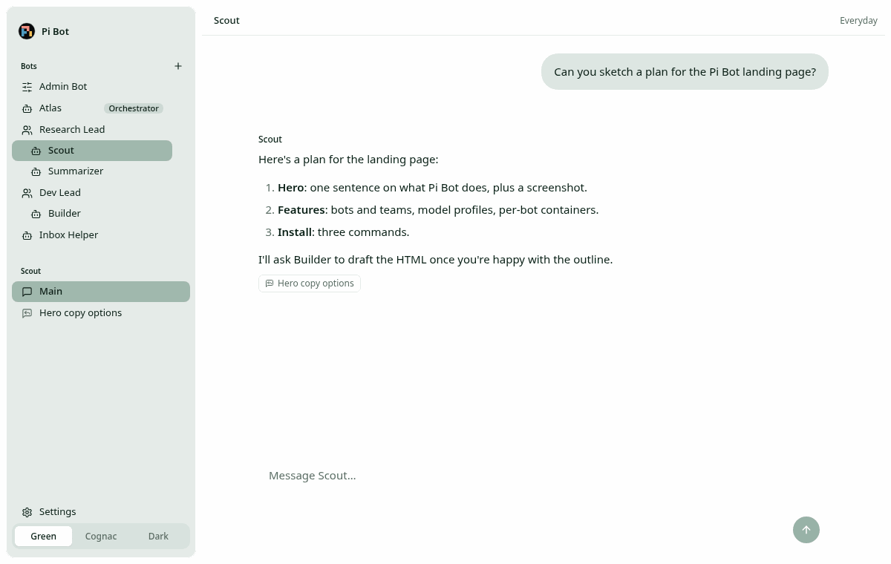
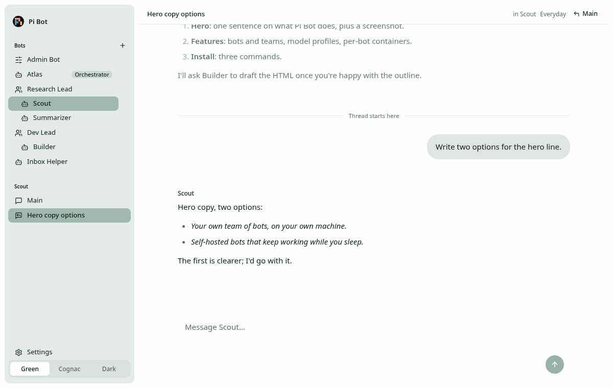

# Bots and teams

## Roles

Roles describe what a bot does and are separate from its name.

- **Admin Bot** is created on first start. There is exactly one; it can't be deleted, renamed or
  put on a team. It is the only bot with account and config tools, confirms config changes you
  didn't ask for, and never asks for secrets in chat. Its first conversation asks about your
  subscriptions, keys and budget, proposes profiles and creates the bots and teams you want.
- **Orchestrator** (optional, at most one) oversees every bot and team. It is never a team member
  but may lead its own team. Setting a new one replaces the old, which stays a normal bot.
- **Managers** lead one-level teams. Any bot but Admin Bot can be a manager; managers have no
  manager. Demoting or deleting a manager ungroups its team.
- **Bots**: everyone else, team members included.

The sidebar pins Admin Bot, then the orchestrator, then nests members under their manager.
Manage all of this in Settings → Bots, by asking Admin Bot, or by telling a bot itself.

## Sidebar groups

Sidebar groups are placement only, separate from teams, roles and messaging. The server stores
an ordered list of `{ id, name, position }` records and an optional `groupId` on each bot.
Admin Bot cannot join a group. Deleting a group leaves its members ungrouped; purging a bot
removes its membership. Soft deletion preserves placement for restoration.

Hosts manage groups through `groups.list/create/rename/delete/reorder` and `bots.setGroup`
(`groupId: null` clears placement). Reordering supplies every group id exactly once. Changes
push `groups.changed`; membership changes also push `bots.changed`. Woven Matter provides the
group sidebar; the standalone sidebar keeps its existing team layout.

## Bot tools

| Who                 | Tools                                                                                                                                                                                                                                                                                                                                        |
| ------------------- | -------------------------------------------------------------------------------------------------------------------------------------------------------------------------------------------------------------------------------------------------------------------------------------------------------------------------------------------- |
| Every bot           | `list_bots`, `create_bot`, `message_bot`, `web_search`, `fetch_url`, `search_history`, `read_thread`                                                                                                                                                                                                                                         |
| Every bot but Admin | `rename_me`, `my_team` (`start`, `add`, `remove`, `stop`, `become_orchestrator`, `stop_orchestrator`)                                                                                                                                                                                                                                        |
| Admin Bot only      | `rename_bot`, `set_team` (`promote`, `demote`, `join`, `leave`, `replace_manager`, `make_orchestrator`, `clear_orchestrator`), `settings_status`, `read_config`, `update_config`, `restart_server`, `list_profiles`, `save_profile`, `delete_profile`, `set_default_profile`, `set_bot_profile`, `read_account_notes`, `write_account_notes` |
| Main models         | `run_subagent` on `"self"` (the conversation's current model) or a profile pool model; subagents get no bot tools and never nest                                                                                                                                                                                                             |
| With Docker on      | `bash`, `read`, `write`, `edit`, run in the bot's container ([environments](environments.md))                                                                                                                                                                                                                                                |
- **`web_search`** `{query, count?}` (1–10, default 5) uses `[search] provider`; if that provider
  has no key, the first of Exa, Brave and Firecrawl that has one (the result says so). It returns
  a numbered list: title, URL, date when known, a one-line snippet. Without any search key it
  says to add one in Settings → Search. **`fetch_url`** `{url, maxChars?}` returns one public
  page as readable text (see [security](security.md#web-tools) for what it refuses). Both are
  offered to every bot and its subagents whether or not a key is set, so the tool list stays the
  same; Claude models get them through the same inventory as every other tool.
- **`search_history`** `{query, limit?}` (1–50, default 10) finds a case-insensitive substring in
  the bot's own main channel and threads and returns snippets, newest first, with conversation id,
  entry id and thread title. **`read_thread`** `{threadId, limit?}` (1–200, default 40) returns a
  thread's (or the main channel's) own messages as a compact transcript, each clipped to 2,000
  characters; messages a thread inherited from its parent belong to the parent. Both read only the
  calling bot's conversations (never another bot's or a subagent's) and are not given to subagents.
- **`create_bot`**: a bot created by a manager or team member joins that team.
- **`message_bot`** delivers to the target's main channel, labelled with the sender, queued if
  the target is busy. It doesn't wait for a reply; the target answers with `message_bot`. A bot
  can't message itself, and each sender→target pair is limited by
  `[bot_to_bot] max_messages_per_hour_per_pair` (default 30, sliding hour, in memory).
- **Rounds per request.** A request is the chain of bot-to-bot messages after one user message.
  A user message is round 0 for the conversation it goes to; a `message_bot` call delivers round
  _n_ + 1, where _n_ is the round the sending conversation last received. Past
  `[bot_to_bot] max_rounds_per_request` (default 5) `message_bot` returns a tool error telling the
  bot to reply to the user instead. Rounds are kept in memory per bot and conversation; a restart
  starts them at 0, and a subagent's child conversation starts at 0.
- **Names** are 1–80 characters and not unique. Admin Bot is always "Admin Bot".

## Main channel and threads

Each bot is one Pi Durable session with one long-lived **main** channel. A **thread** forks off
any message of the main channel or another thread and inherits the context up to that message.
Threads are titled automatically from their first message and can't be renamed. Both compact the
same way ([configuration](configuration.md#compaction)).

**Stop** (the square button beside Send, or Esc in the composer) ends the reply streaming in the
open main channel or thread (`conversation.abort`). It uses Pi Durable's `Conversation.abort()`:
the run, its tool calls and subagents are aborted, messages queued behind the reply are dropped
(never answered), and the partial reply stays in the transcript marked "Stopped". Claude Agent
SDK turns are cancelled through the SDK's abort controller. The next message starts a fresh reply.

## Deleting and restoring

Only you delete bots, from the UI. Deletion is soft: the bot gets a `deleted_at` stamp and all its
tables, threads and history stay. Its container is stopped, its volume kept. A deleted bot is
hidden, not loaded at startup and can't be messaged. **Settings → Bots → Deleted bots** lists them
with a **Restore** button, which brings the bot back with all its history. Bots can create bots but
never delete, restore or purge them.

**Delete permanently** (next to Restore, behind a confirm dialog) purges a deleted bot
(`bots.purge`, refused for live bots and Admin Bot). In one database transaction it drops every
table under the bot's `pibot_<id>_` prefix (its Pi Durable session: main channel, threads,
entries, tasks, documents), its thread rows and its registry row (profile assignment, team and
orchestrator flags); then it removes its Docker container and workspace volume and forgets its
bot-to-bot message counts. Usage limits are per model, not per bot, so nothing there changes. Other
bots' conversations (messages they received from it) are theirs and stay. It can't be undone.

## Thread navigation and pins

Threads sit under Main with the desktop sidebar's 8-point indent. Pinned threads appear first;
each group is newest creation first (replies do not reorder it). Pin/unpin using the row action
or its context menu. Pins live in the shared database and update connected clients.

Opening from the sidebar (or an existing direct link) fills the chat area. Starting or opening
from a message uses a resizable right pane alongside Main when there is enough room. The header
switches between full width and side by side; Close returns to Main. Narrow layouts show one
conversation at a time. Both panes retain their drafts and scrolling through layout changes.
The thread shows its starting message and its own replies, without faded inherited history.
The **Started from** card contains that one original message in full, never a concatenation of
earlier Main messages.
Its model still inherits the conversation up to the starting message; later Main messages and
thread replies do not automatically copy between conversations. Existing threads remain intact.

Unsent text and text-file attachments also survive closing and switching threads within the
client. Drafts stay in memory, are isolated by bot and conversation, and survive switching
bots and settings. An accepted send clears its draft;
reloading the page clears all drafts. New
threads open at the top so their starting message remains visible before the first reply.

## Woven Matter host

Woven Matter runs this server as a dependency and draws everything itself in native SwiftUI over
the WebSocket protocol. It never loads the web client, which stays this repo's standalone UI.

`message.send` takes optional host context of at most 4000 characters: what the user has open
beside the bot right now. The model sees it before that user turn; displayed transcripts strip it,
as with fallback notes.
Bot-to-bot messages cannot set host context. Woven notifications use ordinary `message.send`
to a bot's main channel, with text labelled as coming from Woven Matter.

`woven.connect { endpointURL, bearerToken }` configures a Woven MCP endpoint without restarting;
`woven.status` reports `disconnected`, `connecting`, `ready` or `unavailable`, endpoint and tool
count, and `woven.disconnect` removes the connection and credential. These requests are
user/host-only. The token is write-only in a dedicated credential slot, never a Settings account.
The endpoint and last good tool inventory persist in the database; startup restores them without
network discovery. Connecting refreshes the list for existing bots and threads. Failed discovery
keeps the last good list; calls return a clear error when Woven is unavailable. Calls time out
after two minutes and support user cancellation.

Every bot, including Admin Bot, gets the `woven_*` tools on its main channel and threads;
`run_subagent` children do not. Claude uses the same inventory through its existing inventory-only
MCP server. Text, images, errors and structured results are retained. Only server-declared,
idempotent reads may replay; missing request IDs are persisted per tool task. Browser, computer
and HTML preview cancellation is forwarded to Woven's cancellation tools. Bots can launch and
manage agent sessions with `woven_sessions_*`, including coding when Docker is disabled.

`hello` and `/health` advertise protocol 1, a database-persisted installation UUID and capabilities
`groups`, `woven.mcp`, `message.context`. Hosts should gate each feature on them.

`pnpm package:woven --out <file>` builds a deterministic gzip tar containing `manifest.json`
(commit, server version, protocol and lockfile SHA-256), the root manifests/lockfile/LICENSE,
server manifest/dist/docker and the web manifest, which the workspace lockfile needs. It contains
no web client, dependencies or runtime data.
Install dependencies on the target with
`pnpm install --prod --frozen-lockfile --filter @wovenmatter/pi-bot...`.
Packaging builds only the server, so it never advances `.preview-build-number`.
