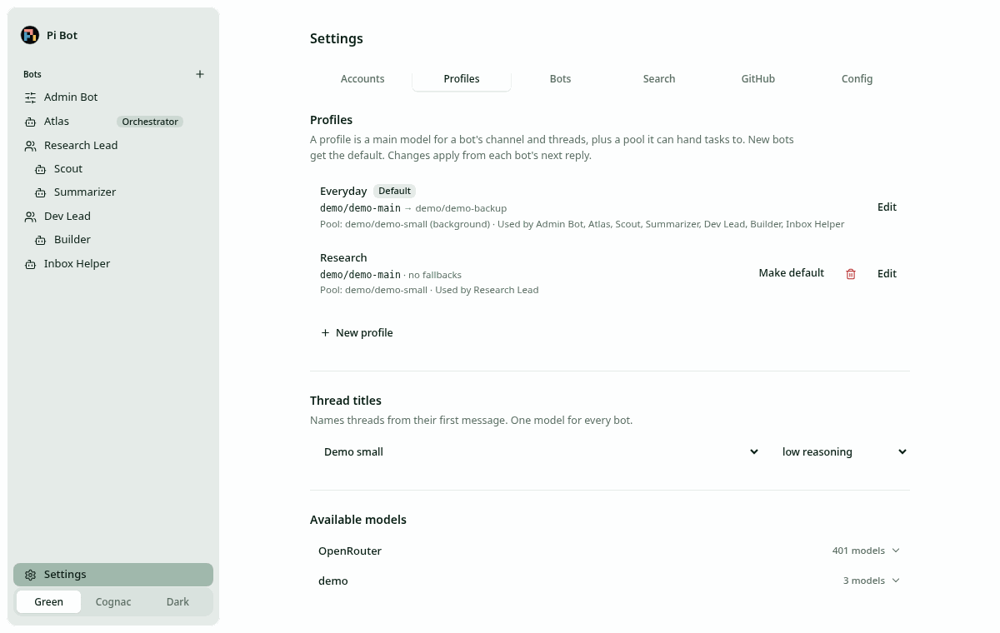

# Configuration

Pi Bot reads one TOML file, required at startup: `--config <path>`, else `$PI_BOT_CONFIG`, else
`~/.config/pi-bot/config.toml`. Start from [`config.example.toml`](../config.example.toml), which
lists every key with its default. Unknown keys are rejected. Secrets never go in this file.

## Sections

| Section           | Keys and defaults                                                                                                                  |
| ----------------- | ---------------------------------------------------------------------------------------------------------------------------------- |
| `[server]`        | `host = "127.0.0.1"` (loopback or tailnet only, see [security](security.md)), `port = 4317`, optional `web_dir`                    |
| `[storage]`       | `data_dir = "~/.local/share/pi-bot"`: the shared `pi-bot.sqlite` (0600) and the credential key                                     |
| `[models]`        | `default_profile`; legacy `orchestrator` / `background` keys are migrated into a `default` profile on first start                  |
| `[models.titles]` | Thread-title model, default `openai-codex/gpt-6-luna`, `reasoning = "high"`                                                        |
| `[profiles.<id>]` | Model profiles, below                                                                                                              |
| `[compaction]`    | `enabled`, `reserve_tokens = 16384`, `keep_recent_tokens = 20000`, `background_tokens = 0`, `native = "auto"`, per-model overrides |
| `[bot_to_bot]`    | `max_messages_per_hour_per_pair = 30`; `max_rounds_per_request = 5` (see [bots and teams](bots-and-teams.md))                      |
| `[extraction]`    | `schedule` (cron), `timezone`: validated only; scheduled extraction doesn't run yet                                                |
| `[search]`        | `provider = "exa"` (or `brave`, `firecrawl`); stored for a search tool that doesn't exist yet                                      |
| `[git]`           | `user_name`, `user_email`: commit identity in bot containers                                                                       |
| `[environment]`   | `backend = "none"` or `"docker"`, optional `image`; see [environments](environments.md)                                            |
| `[credentials]`   | `backend = "auto"` (always encrypted SQLite today), optional `key_file`; see [security](security.md)                               |

## Model profiles

Models are written `provider/model-id` from the pi-ai catalog. Every bot runs one profile; a bot
with none assigned runs the default.

```toml
[models]
default_profile = "default"

[profiles.default]
name = "Default"
main = "openai-codex/gpt-6-sol"
fallbacks = ["claude-subscription/claude-opus-5-5", "openrouter/openai/gpt-6.1-sol"]  # 0–5
guidance = "Use the cheap pool models for lookups and summaries."

[profiles.default.pool."openrouter/anthropic/claude-sonnet-5"]
use_for = "Careful writing and code review"
```

- **Main model** runs the main channel and every thread.
- **Pool**: if non-empty, the main model gets `run_subagent {model, task, reasoning?}`, which runs
  the task on a pool model in a separate child conversation and returns the result. A failure
  comes back as an error, so the main model can try another pool model and tell you in one line.
  `background = true` marks at most one pool entry for background work, which nothing uses yet.
- **Fallbacks** (at most 5, no duplicates, not the main model) only cover the main model.
- Edit profiles in Settings → Profiles or ask Admin Bot. Changes apply from each bot's next reply.
  Deleting a profile moves its bots back to the default; the default can't be deleted.



## Usage limits and fallbacks

When a main-model request fails, Pi Bot classifies the error from the provider's own signals
(status, rate-limit headers, error body, Claude Agent SDK events):

| Kind                                       | What happens                                      |
| ------------------------------------------ | ------------------------------------------------- |
| 5-hour, weekly or other subscription limit | Model marked unavailable until the reported reset |
| API key out of credits or quota            | The whole provider account is marked unavailable  |
| Transient rate limit (429, overloaded)     | Normal retry with backoff; no fallback            |

With no reported reset, a ~15-minute cooldown applies, then the next request probes again. Every
bot whose chain includes that model moves to the first available fallback, and switches back
(with a short "back on …" notice) when the main model resets. With no fallback left the bot
pauses on its main model. The chat shows a banner with what was hit, the account and model, the
reset time in your local zone (or "reset time not reported") and the fallback in use; the sidebar
shows a dot. Pool models never switch automatically.

Marked limits are saved in SQLite (`pibot_limits`) and restored on start; any whose reset or
cooldown has passed is dropped. Writing a provider's credentials through the server (Settings or
Admin Bot: a key set or removed, or a sign-in to ChatGPT, Claude or Grok that completes) clears
that provider's marked limits, and its bots switch back to their main model. Credentials changed
by the `pi-bot` CLI in another process don't clear them; the limit then ends at its reset or
cooldown, or on the next credential change through the server.

## Compaction

The main channel and threads compact the same way. Pi Durable decides when (thresholds or
context overflow) and what prefix to cover. With `native = "auto"`, these providers use their own
compaction API: `openai`, `xai`, `openai-codex`, `anthropic` and `claude-subscription`. Everything
else (OpenRouter, OpenCode Go) uses Pi Durable's summarizer, which is also the fallback when a
native call fails. Covered history stays in SQLite; only the model context gets shorter.

## Thread titles

A thread's title is generated once, in the background, from its first message by the
`[models.titles]` model (max 50 characters). Threads can't be named or renamed by hand; the main
channel has no title. A failed request leaves the thread "Untitled thread".

## Settings page

`#/settings` has six tabs: **Accounts** (sign-ins, keys, plans-and-budget notes), **Profiles**
(profiles, title model, available models), **Bots** (orchestrator, roles, teams, profiles,
renames, deleted bots), **Search** (Exa, Brave, Firecrawl keys and provider), **GitHub** (SSH key
and git identity) and **Config** (bot-to-bot and extraction fields, the raw `config.toml` with
validation, and **Restart Pi Bot**).

Every config write is validated first, written atomically and keeps comments. Config changes
need a restart: a "Restart and apply" notice stays pinned until you do. A restart re-reads and
validates the file (an invalid file is refused), lets running turns finish for up to 15 s, then
restarts in-process, or exits with `PIBOT_RESTART_EXIT_CODE` for a supervisor. Unfinished turns
resume through Pi Durable.

## Running as a service

On Linux, a systemd user service with lingering on starts Pi Bot at boot:

```ini
# ~/.config/systemd/user/pi-bot.service
[Unit]
Description=Pi Bot
After=network-online.target

[Service]
WorkingDirectory=%h/Projects/pi-bot
ExecStart=/usr/bin/node packages/server/dist/cli.js serve
Environment=PIBOT_RESTART_EXIT_CODE=75
Restart=always
RestartSec=1

[Install]
WantedBy=default.target
```

```sh
systemctl --user enable --now pi-bot
loginctl enable-linger $USER
sudo systemctl enable docker                                   # only with backend = "docker"
tailscale serve --bg --https=10443 http://127.0.0.1:4317       # tailnet only; never funnel
```
