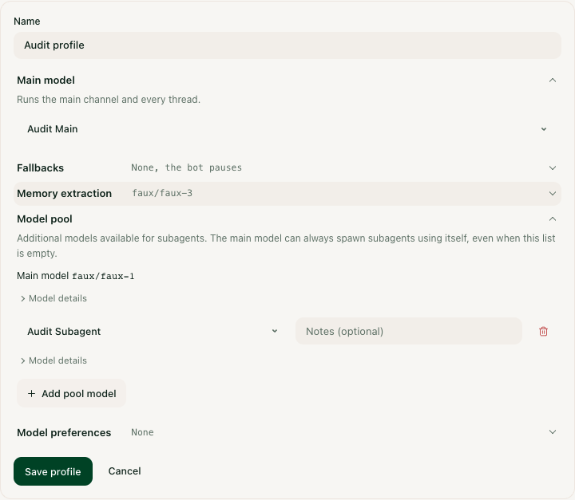

# Configuration

Pi Bot reads one TOML file, required at startup: `--config <path>`, else `$PI_BOT_CONFIG`, else
`~/.config/pi-bot/config.toml`. Start from [`config.example.toml`](../config.example.toml), which
lists every key with its default. Unknown keys are rejected. Secrets never go in this file.

## Sections

| Section           | Keys and defaults                                                                                                                  |
| ----------------- | ---------------------------------------------------------------------------------------------------------------------------------- |
| `[server]`        | `host = "127.0.0.1"` (loopback or tailnet only, see [security](security.md)), `port = 4317`, optional `web_dir`                    |
| `[storage]`       | `data_dir = "~/.local/share/pi-bot"`: the shared `pi-bot.sqlite` (0600) and the credential key                                     |
| `[models]`        | `default_profile`; legacy `orchestrator` / `background` keys become a `default` profile (main / `memory_model`) on first start     |
| `[models.titles]` | Thread-title model, default `openai-codex/gpt-6-luna`, `reasoning = "high"`                                                        |
| `[profiles.<id>]` | Model profiles, below                                                                                                              |
| `[compaction]`    | `enabled`, `reserve_tokens = 16384`, `keep_recent_tokens = 20000`, `background_tokens = 0`, `native = "auto"`, per-model overrides |
| `[bot_to_bot]`    | `max_messages_per_hour_per_pair = 30`; `max_rounds_per_request = 5` (see [bots and teams](bots-and-teams.md))                      |
| `[extraction]`    | `enabled = true`, `schedule = "0 3 * * *"` (cron), `timezone = "UTC"`, `idle_minutes = 30`; see [memory](#memory)                  |
| `[search]`        | `provider = "exa"` (or `brave`, `firecrawl`): tried first by `web_search`; keys in Settings → Search                               |
| `[git]`           | `user_name`, `user_email`: commit identity in bot containers                                                                       |
| `[environment]`   | `backend = "none"` or `"docker"`, optional `image`; see [environments](environments.md)                                            |
| `[credentials]`   | `backend = "auto"` (always encrypted SQLite today), optional `key_file`; see [security](security.md)                               |

## Model profiles

Models are written `provider/model-id` from the pi-ai catalog. Every bot runs one profile; a bot
with none assigned runs the default.

```toml
[models]
default_profile = "default"

[profiles.default]
name = "Default"
main = "openai-codex/gpt-6-sol"
fallbacks = ["claude-subscription/claude-opus-5-5", "openrouter/openai/gpt-6.1-sol"]  # 0–5
memory_model = "openai-codex/gpt-6-luna"   # optional; unset: the active main model
guidance = "Sonnet writes nicer prose. Sol is thorough. Double-check Luna on anything subtle."

[profiles.default.pool."openrouter/anthropic/claude-sonnet-5"]
use_for = "Careful writing and code review"   # optional note
```

- **Main model** runs the main channel and every thread.
- **Subagents**: every bot's main model has `run_subagent {model, task, reasoning?}`, which runs
  the task in a separate child conversation and returns the result. `model` is `"self"` (the model
  the calling conversation runs right now: the main model, or the active fallback while main is
  limited) or one of the profile's pool models; nothing else is accepted. A pool model that is
  the current model is listed once, as self, with its notes. The child keeps the bot's coding
  tools (with a container) and web tools, which the prompt names, but none of its bot tools
  (messaging and managing bots, teams, settings and config, account notes, history search and
  reading), its identity, memory or `run_subagent`, so subagents never nest. A failure comes back as an error, so the main model can
  try another listed model and tell you in one line. Messaging other bots (`message_bot`) is
  separate and unchanged; the main model can use either as it sees fit.
- **Model pool** (`pool`): additional models for subagents; it may be empty, since the main model
  can always use itself. `use_for` is an optional note per model.
- **Model preferences** (`guidance`): your own words about the models ("Opus writes nicer code",
  "Sol is thorough", "check Astra's work"). The main model weighs them with the task and each
  model's facts; there is no enforced routing.
- **Model facts in the prompt**: for self and every pool model the main model sees the catalog's
  context window, max output, input modalities and reasoning support, the provider's raw API list
  price (input, output, cache read, cache write, in USD per million tokens, at the catalog's
  full precision, with every input-size tier listed), how the provider is reached (subscription or API key), whether it is signed in, and a
  marked usage limit with its reset when the provider gave one. Prices come from the model entry
  pi-ai serves for that exact `provider/model-id`; the source is named (pi-ai version and catalog
  date) only when that entry matches pi-ai's bundled catalog, otherwise it is called the
  provider's own list. `claude-subscription` serves pi-ai's Anthropic entries under the same ids,
  so its prices are Anthropic's API prices. They are a relative cost signal, also when comparing
  models reached through a subscription, not an exact conversion to a subscription's allowance or
  charges. A model missing from the
  catalog has an unknown price, and an all-$0 entry reads "free or unpriced", never "free". No
  quality scores are shown. Settings → Profiles shows the same facts under each model.
- **Memory extraction** (`memory_model`): the model that reviews new conversation messages and
  saves useful facts into the bot's [memory](#memory). Unset ("Use active main model"): the main
  model the bot runs at that moment. It never affects chat, subagents or titles.
- **Fallbacks** (at most 5, no duplicates, not the main model) only cover the main model.
- Edit profiles in Settings → Profiles or ask Admin Bot. Changes apply from each bot's next reply.
  Deleting a profile moves its bots back to the default; the default can't be deleted.
- **Older configs**: a pool entry with `background = true` is read as that profile's
  `memory_model` (an explicit `memory_model` wins) and has no other meaning; on start Pi Bot
  rewrites it in place (comments and layout kept, other edits untouched, through the same
  serialized config writer as every other save). A flag it can't reach with a line edit (an
  inline table) is left as is and still read the same way. `run_subagent` no longer accepts
  `"background"`. Legacy `[models] background` becomes the default profile's `memory_model`.

In the editor, pricing and capabilities are collapsed under each model's **Model details**. The main model still receives the full metadata for subagent selection.



Example shown with test models and synthetic prices; actual prices come from the model catalog.

## Usage limits and fallbacks

When a main-model request fails, Pi Bot classifies the error from the provider's own signals
(status, rate-limit headers, error body, Claude Agent SDK events):

| Kind                                       | What happens                                      |
| ------------------------------------------ | ------------------------------------------------- |
| 5-hour, weekly or other subscription limit | Model marked unavailable until the reported reset |
| API key out of credits or quota            | The whole provider account is marked unavailable  |
| Transient rate limit (429, overloaded)     | Normal retry with backoff; no fallback            |

With no reported reset, a ~15-minute cooldown applies, then the next request probes again. Every
bot whose chain includes that model moves to the first available fallback, and switches back
(with a short "back on …" notice) when the main model resets. With no fallback left the bot
pauses on its main model. The chat shows a banner with what was hit, the account and model, the
reset time in your local zone (or "reset time not reported") and the fallback in use; the sidebar
shows a dot. Pool models never switch automatically.

While a bot answers on a fallback, each turn's input starts with a short note for the model
(`[Note: <main> is unavailable (5-hour limit); you are <fallback>. Mention this briefly in your
reply.]`), so the reply says so. The note is part of the stored user turn, never the system
prompt, and the chat hides it. The turn that was switched mid-way gets it for its retried
requests only.

Marked limits are saved in SQLite (`pibot_limits`) and restored on start; any whose reset or
cooldown has passed is dropped. Writing a provider's credentials through the server (Settings or
Admin Bot: a key set or removed, or a sign-in to ChatGPT, Claude or Grok that completes) clears
that provider's marked limits, and its bots switch back to their main model. Credentials changed
by the `pi-bot` CLI in another process don't clear them; the limit then ends at its reset or
cooldown, or on the next credential change through the server.

## Compaction

The main channel and threads compact the same way. Pi Durable decides when (thresholds or
context overflow) and what prefix to cover. With `native = "auto"`, these providers use their own
compaction API: `openai`, `xai`, `openai-codex`, `anthropic` and `claude-subscription`. Everything
else (OpenRouter, OpenCode Go) uses Pi Durable's summarizer, which is also the fallback when a
native call fails. Covered history stays in SQLite; only the model context gets shorter.

## Memory

Each bot has a memory: a list of durable facts and preferences (at most 200, oldest dropped),
shown to it as a `memory` prompt section. It changes only when facts are added or edited, so the
prompt stays cacheable. Extraction runs one bot at a time, in the background, on the `[extraction]`
schedule (in `timezone`) and once a bot has been idle `idle_minutes` after new messages. It reads
the user and assistant messages of the main channel and threads since the bot's checkpoint
(`pibot_memory`, the newest entry id read; at most the newest ~60k characters per run), asks the
profile's `memory_model` (else, and as a quiet fallback, the main model as it runs now; limited
models are skipped) for new facts,
drops ones already known (case and punctuation ignored) and saves facts and checkpoint together.
Bots with nothing new are skipped; a failed run leaves the checkpoint and is retried after another
idle period or on the next schedule. Errors only go to the server log. Set `enabled = false` to
turn it off.

**Settings → Bots → Memory** shows one bot's facts (pick it from the list) and lets you edit a
fact in place, delete one or add your own (up to 1000 characters, one line; a fact already in
memory is refused). Changes apply from the bot's next reply and show up in every open browser.
Extraction adds its new facts to the memory as it is when it saves, so your edits are kept, and
facts you deleted come back only if a later conversation brings them up again.

## Thread titles

A thread's title is generated once, in the background, from its first message (max 50
characters), always with the global `[models.titles]` model (default `openai-codex/gpt-6-luna`
when the file sets none) for every bot. Profiles (main, pool or memory model) never take part, and
there is no fallback model. Threads can't be named or renamed by hand; the main channel has no
title. A failed request leaves the thread "Untitled thread".

## Settings page

`#/settings` has six tabs: **Accounts** (sign-ins, keys, plans-and-budget notes), **Profiles**
(profiles, title model, available models), **Bots** (orchestrator, roles, teams, profiles,
renames, each bot's [memory](#memory), deleted bots), **Search** (Exa, Brave, Firecrawl keys and provider), **GitHub** (SSH key
and git identity) and **Config** (bot-to-bot and extraction fields, the raw `config.toml` with
validation, and **Restart Pi Bot**).

Every config write is validated first, written atomically and keeps comments. Config changes
need a restart: a "Restart and apply" notice stays pinned until you do. A restart re-reads and
validates the file (an invalid file is refused), lets running turns finish for up to 15 s, then
restarts in-process, or exits with `PIBOT_RESTART_EXIT_CODE` for a supervisor. Unfinished turns
resume through Pi Durable.

## Running as a service

On Linux, a systemd user service with lingering on starts Pi Bot at boot:

```ini
# ~/.config/systemd/user/pi-bot.service
[Unit]
Description=Pi Bot
After=network-online.target

[Service]
WorkingDirectory=%h/Projects/pi-bot
ExecStart=/usr/bin/node packages/server/dist/cli.js serve
Environment=PIBOT_RESTART_EXIT_CODE=75
Restart=always
RestartSec=1

[Install]
WantedBy=default.target
```

```sh
systemctl --user enable --now pi-bot
loginctl enable-linger $USER
sudo systemctl enable docker                                   # only with backend = "docker"
tailscale serve --bg --https=10443 http://127.0.0.1:4317       # tailnet only; never funnel
```

GitHub settings use one shared SSH key for all bots and show account setup links alongside
its public key. The identity form edits only the shared author name; saving it preserves any
configured `git.user_email`. Containers use `bot@pi-bot.invalid` when no commit email is
configured. This fallback does not claim GitHub author attribution and does not affect account
notifications. An explicit `git.user_email` remains supported in config and the API.
