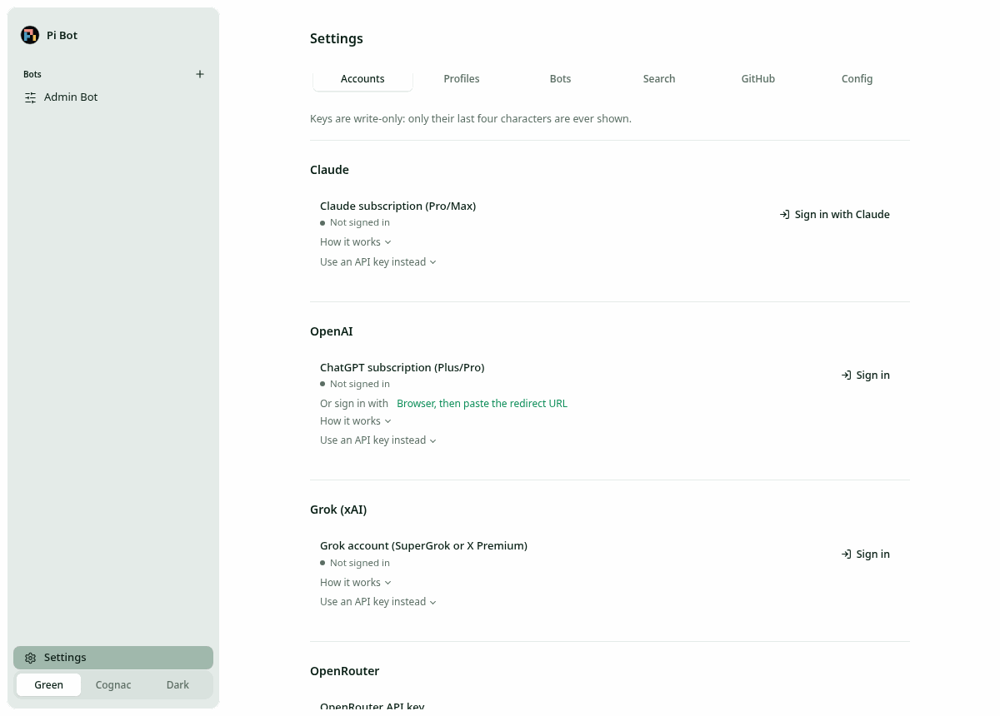

# Providers and sign-in

Sign in or add keys in Settings → Accounts (or during onboarding). One provider is enough to
start. Credentials are shared by all bots and apply immediately. Keys are write-only: the UI shows
at most the last four characters, and no response carries a stored secret. Variables already in
the server's environment show as "From …" and can't be removed in the UI.

## Model providers

| Account                               | Model prefix          | How you connect                                                       |
| ------------------------------------- | --------------------- | --------------------------------------------------------------------- |
| Claude subscription (Pro/Max)         | `claude-subscription` | **Sign in with Claude** (runs `claude setup-token`), or paste a token |
| Anthropic API key                     | `anthropic`           | Key, under "Use an API key instead" on the Claude row                 |
| ChatGPT subscription (Plus/Pro)       | `openai-codex`        | Device code, or browser plus pasting the redirect URL                 |
| OpenAI API key                        | `openai`              | Key, under the ChatGPT row                                            |
| Grok account (SuperGrok or X Premium) | `xai`                 | Device code; shares one credential slot with the xAI key              |
| xAI API key                           | `xai`                 | Key, under the Grok row                                               |
| OpenRouter                            | `openrouter`          | API key                                                               |
| OpenCode Go                           | `opencode-go`         | API key                                                               |

Settings → Profiles lists the models each connected provider offers. Settings → Accounts also has
**Plans and budget** notes (your plans, tiers and comfortable monthly spend): guidance for Admin
Bot, not caps, and never secrets.

## Search providers

Settings → Search stores keys for **Exa** (default), **Brave Search** and **Firecrawl**, plus the
`[search] provider` choice. No bot has a web search tool yet, so these are stored for later.

## Headless sign-in

Every sign-in works from a browser on any device. The server never opens a browser, and nothing
has to reach a localhost callback on the server machine.

- **ChatGPT**: **Sign in** shows a code and a link to `auth.openai.com/codex/device`. Enter the
  code anywhere and approve; Pi Bot polls and finishes (15-minute limit). If device-code sign-in
  is off for your account, use **Browser, then paste the redirect URL**: approve, and when the
  browser lands on a `localhost:1455` page that won't load, paste that whole URL back.
- **Claude**: **Sign in with Claude** runs Anthropic's own, unmodified Claude Code
  `claude setup-token` in a pseudo-terminal with a throwaway config dir. The row shows the
  sign-in link; you approve in any browser, paste the code Claude shows, and Claude Code prints a
  one-year `sk-ant-oat…` token, which Pi Bot stores encrypted. Without a usable `claude` binary
  or PTY, the row shows terminal steps and takes a pasted token. There is no refresh; after a
  year the row says it expired and you sign in again.
- **Grok**: **Sign in** shows a code and an auth.x.ai link; approve there. xAI refuses some tiers
  with a 403; the xAI API key in the same slot is the fallback.

OAuth refreshes run inside the credential store's per-slot lock, so each provider has one
serialized refresher.

From a terminal: `pi-bot login openai-codex | claude-subscription | xai`,
`pi-bot set-key <provider>` (hidden input or stdin; `claude-subscription` takes a setup-token),
`pi-bot credentials` and `pi-bot logout <provider>` (run as
`node packages/server/dist/cli.js …`).

## Claude via the Agent SDK

`claude-subscription` runs Claude through `@anthropic-ai/claude-agent-sdk` (pinned, proprietary,
Anthropic Commercial Terms). An `sk-ant-oat…` token is passed as `CLAUDE_CODE_OAUTH_TOKEN`, any
other key as `ANTHROPIC_API_KEY`. Each turn runs Claude Code with a private `CLAUDE_CONFIG_DIR`
under the data dir, a filtered environment, no built-in tools or settings, and `maxTurns: 1`.
Pi Bot's tools are listed to Claude but executed by Pi Bot (in the bot's container when Docker is
on). Every turn starts a Claude Code process and replays the transcript. This path has been tested
only against a fake `query()`, never with a real token.

## Claude caveat

Pi Bot uses only documented pieces: `claude setup-token` and `CLAUDE_CODE_OAUTH_TOKEN` are
Anthropic's documented way to run Claude Code where browser login isn't available, and the Agent
SDK docs allow a user signing in to the unmodified Claude Code binary with their own
subscription. The same pages say third-party products may not "collect, store, or intermediate
Claude.ai credentials or session tokens" without Anthropic's approval. Pi Bot is a tool you host
for yourself and sign-in happens in Anthropic's own flow, but storing the resulting token is
still a gray area. The **Anthropic API key** is the fully sanctioned alternative.
